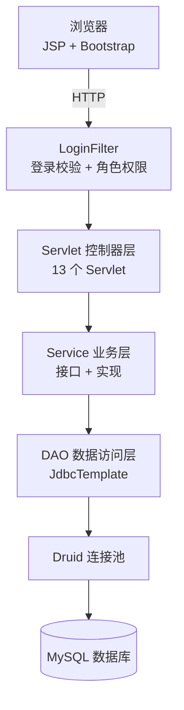

# 🎓 学生选课管理系统

<div align="center">

**基于 JSP + Servlet 的 JavaWeb 三层架构项目 —— 教务管理 · 学生选课 · 通知公告**

   

</div>

## 📖 项目简介

本项目是一个经典的 **JavaWeb 学生选课管理系统**，采用 **Servlet + JSP + JSTL** 三层架构实现，涵盖管理员对教务数据的管理，以及学生选课/退课的完整业务流程。系统基于 Spring JdbcTemplate 与 Druid 连接池访问 MySQL 数据库。

## ✨ 核心功能

### 管理员端

- 📊 **数据看板**：学生数 / 教师数 / 课程数 / 公告数实时统计
- 👨‍🎓 **学生管理**：增删改查、分页、关键字搜索
- 👩‍🏫 **教师管理**：增删改查、分页、搜索
- 📚 **课程管理**：增删改查、关联授课教师
- 📢 **通知公告管理**：增删改查、批量删除
- 🗂️ **选课管理**：查看选课记录、删除选课、统计选课人数/课程数

### 学生端

- 📝 **注册 / 登录**：学号唯一校验、密码确认
- 🔍 **浏览课程**：分页 + 关键字搜索，标记已选状态
- ✅ **选课 / 退课**：AJAX 异步交互，实时返回结果
- 📖 **我的课程**：查看已选课程、统计总学分
- 📢 **通知公告**：查看公告详情
- ⚙️ **个人设置**：修改密码、注销账号

### 通用

- 🔐 **登录安全**：图形验证码（5 分钟有效期、错误 3 次强制刷新）、角色权限控制
- 🎨 **界面**：Bootstrap + jQuery 响应式布局

## 🛠 技术栈

- **后端**：Java、Jakarta Servlet 6.0、JSP、JSTL
- **持久层**：Spring JdbcTemplate + Druid 连接池 + MySQL 8.0
- **前端**：Bootstrap、jQuery
- **构建**：IntelliJ IDEA 工程（传统 JavaWeb 项目，依赖置于 `WEB-INF/lib`）

## 🏗 系统架构



分层职责：

| 层 | 职责 |
|----|------|
| `filter` | `LoginFilter` 全局登录校验 + 基于角色（admin/student）的访问控制 |
| `servlet` | 请求分发、参数校验、页面跳转 / JSON 返回 |
| `service` | 业务逻辑封装（选课/退课、学分统计、分页查询等） |
| `dao` | 基于 `JdbcTemplate` 的 SQL 操作 |
| `domain` | 实体类 + 通用分页组件 `PageBean` |

## 🚀 快速开始

### 环境要求

- JDK 11+
- MySQL 5.7+ / 8.0
- Tomcat 10+（项目使用 Jakarta Servlet 6.0）
- IntelliJ IDEA

### 运行步骤

1. **初始化数据库**：执行项目根目录的 `student_management_system.sql`

   ```bash
   mysql -u root -p < student_management_system.sql
   ```

2. **配置数据库连接**：将 `src/druid.properties.example` 复制为 `src/druid.properties`，并修改为自己的 MySQL 用户名和密码：

   ```properties
   username=root
   password=your_password
   ```

3. **用 IntelliJ IDEA 打开项目**，配置 Tomcat 10+ 作为运行服务器

4. **启动项目**，访问 `http://localhost:8080/`

### 默认账号

| 角色 | 账号 | 密码 |
|------|------|------|
| 管理员 | `admin` | `123456` |
| 学生 | `2021001` | `123456` |

## 📁 项目结构

```
student-management-system
├── src/
│   ├── com/student/
│   │   ├── dao/              # DAO 接口 + impl 实现类
│   │   ├── domain/           # 实体类（Student/Teacher/Course/Notice/...）
│   │   ├── filter/           # LoginFilter 登录过滤器
│   │   ├── service/          # Service 接口 + impl 实现类
│   │   ├── servlet/          # Servlet 控制器
│   │   ├── test/             # JDBC 连接测试
│   │   └── util/             # JDBCUtils（Druid 连接池）
│   └── druid.properties.example   # 数据库配置模板
├── web/
│   ├── admin/                # 管理员端 JSP 页面
│   ├── student/              # 学生端 JSP 页面
│   ├── css/ js/ fonts/ images/  # 前端静态资源
│   └── WEB-INF/lib/          # 项目依赖 jar 包
├── student_management_system.sql   # 数据库初始化脚本
└── README.md
```

## 📝 说明

- 数据库配置文件 `druid.properties` 包含数据库密码，**未纳入版本库**；请基于 `druid.properties.example` 自行创建
- 学生/管理员密码以明文存储，本项目为课程设计用途；生产环境建议使用 BCrypt / MD5 等加密方案
